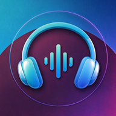
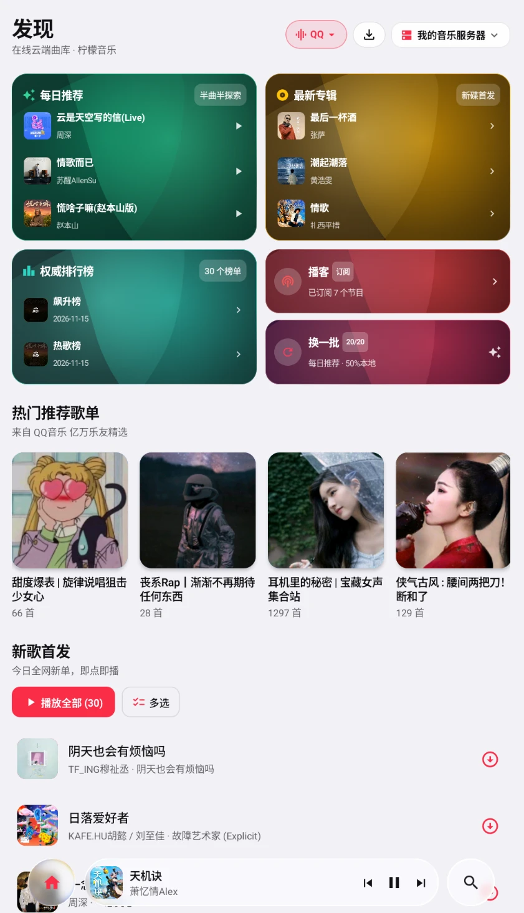
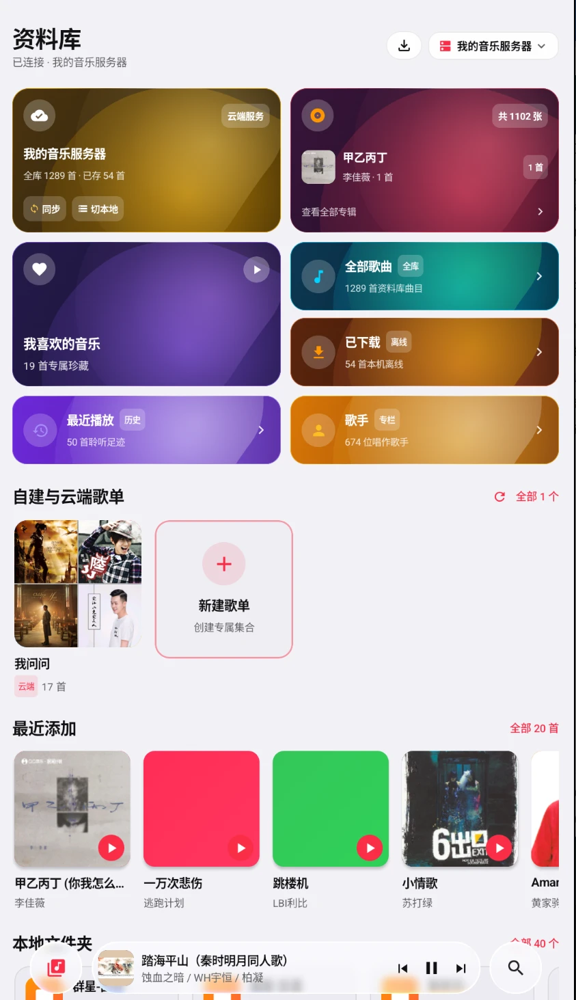
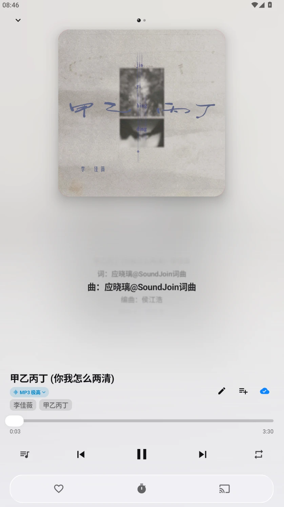
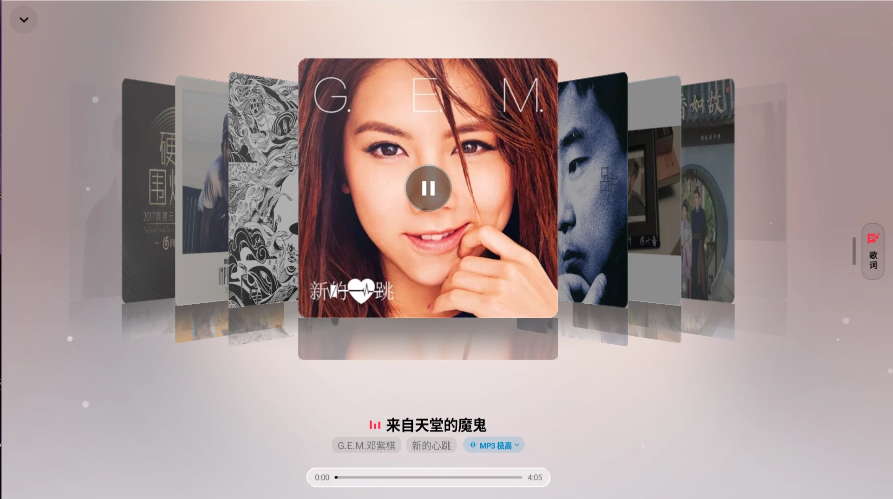

<p align="center">
  
</p>

<h1 align="center">LMPlayer</h1>

<p align="center">柠檬音乐服务端的 Android / iOS 手机客户端</p>

<p align="center">
  <a href="https://github.com/zyhub/LMplayer/releases">下载</a> ·
  <a href="#ios-版">iOS 版</a> ·
  <a href="https://github.com/jia070310/lemon-muisc">柠檬服务端</a> ·
  <a href="https://github.com/zyhub/LMPlayer-tvcar">TV / 车机版</a> ·
  <a href="LICENSE">许可证</a>
</p>

## 简介

LMPlayer 是 [柠檬音乐服务端（lemon-muisc）](https://github.com/jia070310/lemon-muisc) 的客户端，需要连接使用者自己部署的柠檬服务端使用。曲库、歌单、收藏、在线检索与推荐均由服务端提供，客户端本身不内置任何曲库。同时支持扫描播放本机已有的音乐文件。

## 功能

- **液态玻璃界面**：顶栏、底栏、悬浮条与弹窗统一玻璃风格，首次安装按机型性能自动选择效果档位，横竖屏状态栏沉浸适配。
- **播放页**：打开 / 收起可选「神奇效果」缩放动画或滑出动画；逐字歌词、竖屏现代与横屏专辑流两种布局，下载进度实时显示。
- **歌手与专辑页**：「资料库 / 在线」左右切换，在线结果分批加载、分页显示，歌手页汇总专辑。
- **歌单**：与服务端双向同步；支持多选加入、移出歌单，以及原位新建歌单。
- **下载管理**：本机 / 服务器两种下载位置可选，按所选音质下载；下载时写入封面、标签与歌词，支持搜索与多选删除。
- **本地播放加速**：服务器歌曲预匹配、歌词与封面竞速加载、已缓存歌曲直接播放，弱网下切歌更快。
- **更多**：桌面小组件、播客、系统灵动岛 / 超级岛通知歌词、应用内检查更新。

## 截图

| 发现 | 资料库 | 播放页 |
| :---: | :---: | :---: |
|  |  |  |

<p align="center">
  <br />
  横屏播放页 · 专辑流
</p>

## 下载安装

在 [Releases](https://github.com/zyhub/LMplayer/releases) 下载最新的 `LMPlayer-<版本号>.apk`。

- 系统要求：Android 6.0 及以上
- 支持架构：arm64-v8a、armeabi-v7a、x86_64
- 安装包使用固定签名，新版本可直接覆盖安装

### iOS 版

- 在 [Releases](https://github.com/zyhub/LMplayer/releases) 下载对应的 `LMPlayer-iOS-<版本号>.ipa`
- 支持系统：iOS 17.0 及以上（iPhone / iPad / Apple CarPlay）
- 安装方式：支持自签工具、TrollStore（巨魔）或 LiveContainer 安装

## 编译

环境：JDK 17、Android SDK（compileSdk 37）。

```bash
git clone https://github.com/zyhub/LMplayer.git
cd LMplayer
./gradlew :app:assembleDebug
```

签名密钥不包含在本仓库中。编译 release 包需要自备签名文件，详见 `app/build.gradle.kts` 中的签名配置。

## 致谢

- [柠檬音乐服务端 lemon-muisc](https://github.com/jia070310/lemon-muisc)：本应用连接的服务端。
- [Kyant0/AndroidLiquidGlass](https://github.com/Kyant0/AndroidLiquidGlass)（Apache-2.0）：应用的液态玻璃效果（背景采样、模糊与折射）基于该项目的 `backdrop` 与 `shapes` 库实现，底部导航的拖动阻尼动画参考了其示例代码。感谢作者的开源。
- AndroidX Media3、Jetpack Compose、Room、OkHttp、Retrofit、Coil、quickjs-kt 等开源项目，各自遵循其开源许可证。

## 免责声明

本项目仅供个人学习与技术研究，不提供、不存储、不分发任何音频、歌词或封面等版权内容，播放的内容均来自使用者自己部署的服务端或本机文件，相关版权归原权利人所有。请勿将本项目用于任何商业用途，并请支持正版音乐。完整条款见 [DISCLAIMER.md](DISCLAIMER.md)。

## 许可证

[MIT](LICENSE) © 2026 Zhou (zyhub)
